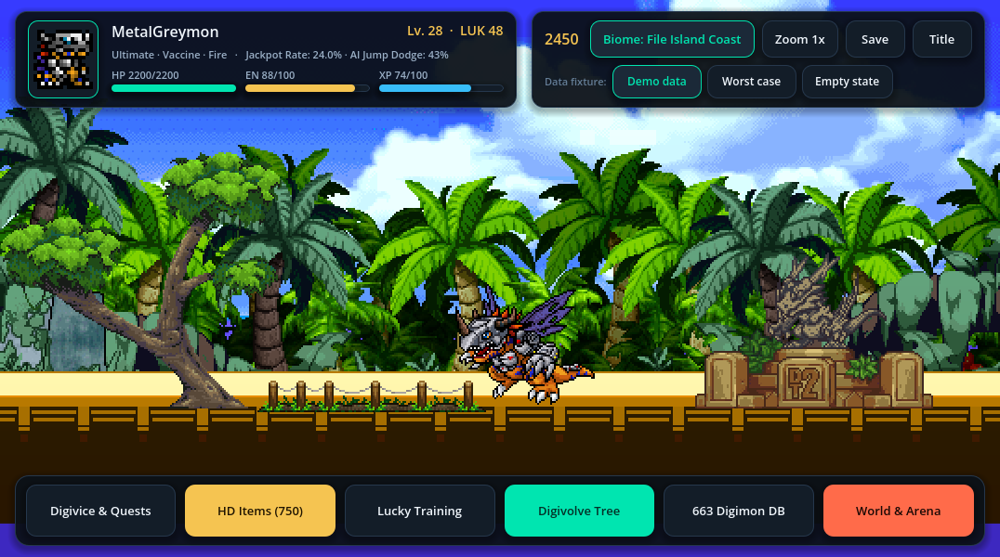

# Digital Tamers 02 — Full Remake & Port (Godot 4.7.2 + Android Native APK)

## Overview
Full reverse-engineering, remastering, and cross-platform port of **Digital Tamers 02 (`v2.0.2`, GameMaker bytecode 17)** into both **Godot 4.7.2 (Windows Desktop)** and **Android Native APK (`com.dragonrod.dt02remake`)**:

1. **D-Terminal OS High-DPI Flagship UI (`TamerUI`)**:
   - Designed on the `design-motion-stack` (`D0`–`D5`) with crisp nearest-neighbor pixel-art scaling (`538×300` world canvas) and dark obsidian HUD cards (`#0B1118` / `#131D28`), emerald vaccine accents (`#00E5B0`), and 777 jackpot gold (`#F5C451`).
2. **1v1 Single-Match ("단판") Auto-Chess & RNG Luck Combat Engine**:
   - Both ally and enemy Digimon autonomously navigate (`walk`), jump (`jump` with gravity `vy`), jump-evade incoming projectiles based on `SPD + LUK` reflex rolls, guard/parry (`block` with `2.4x` Miracle Counter), and auto-cast skills (`atk01`, `atk02`, `atkSP`).
   - Every skill cast rolls a `D100` luck multiplier (`0.55x Graze` ~ `2.2x Crit` ~ `4.0x SSR` ~ `7.77x JACKPOT`) combined with a live 3-reel slot machine (`7·7·7` Fever Overdrive).
3. **Aseprite 1.3.18 Batch Remastered Assets**:
   - **750 HD Item Sprites (`spr_Items_HD`)**: Scale2x/EPX curve interpolation, top-left specular shading, crisp dark outlines, and 4-point star gleams via [`tools/remake_items.lua`](tools/remake_items.lua).
   - **55 HD Stage & Sanctuary Backgrounds (`bg_HD`)**: Atmospheric depth, S-curve contrast, and ground rim highlights across 14 regional battle stages (`bg_Btl_Magma_Mountain`, `bg_Btl_Village_Beginnings`, `bg_Btl_Dark_Area`, etc.) and 6 Sanctuary biomes via [`tools/remake_backgrounds.lua`](tools/remake_backgrounds.lua).
4. **Full Extracted Game Database (`out/data/full_db.json`)**:
   - **663 Digimon** with base stats, attributes, elements, and full English bio descriptions.
   - **436 Evolution Routes** with stat bonuses and instant Digivolution matrix.
   - **748 Items** & **78 Campaign Quests** (EN & PT-BR localization) + persistent JSON Save/Load (`tamer_save_v2.json`).

## Project Structure
- [`godot/`](godot/) — Godot 4.7.2 project (`GM` runtime, `GMBackground` multi-layer biome renderer, `TamerUI`, `obj_Digi_Battle.gd` 1v1 Auto-Chess AI).
- [`android/`](android/) — Native Android APK project (`com.dragonrod.dt02remake`) bundling the 663 Digimon DB, 750 HD items, 55 HD backgrounds, and 1v1 Auto-Chess engine.
- [`tools/`](tools/) — Extraction & Aseprite batch remastering scripts (`extract_full_db.py`, `remake_items.lua`, `remake_backgrounds.lua`, `sync_android_assets.py`).
- [`out/data/`](out/data/) — Extracted `full_db.json`, `sprites.json`, `objects.json`, `rooms.json`.
- [`out/shots/`](out/shots/) — Desktop & Android device verification screenshots.
